<h1 align="center">Hi 👋, I'm Kevin Tri Anggoro</h1>
<h3 align="center">Fullstack Developer | Laravel, React.js | IT Support</h3>

---

### 🚀 About Me
I'm an Informatics Engineering graduate from Universitas Pamulang with a passion for Fullstack Development and building modern, responsive, and user-friendly web applications.

- 💻 Focused on Fullstack Web Development.
- 🚀 Currently building PaduPOS, a Point of Sale & Inventory Management System.
- 🌱 Continuously improving my skills in Laravel, React.js, and Inertia.js.
- 🛠️ Hands-on experience with PHP, JavaScript, and MySQL
- 🎯 Passionate about clean code, problem-solving, and continuous learning.
- 📫 **Contact:** [kevintrianggoro324@gmail.com](mailto:kevintrianggoro324@gmail.com)
- 🌐 [Personal Website](https://kevintrianggoro-porto.vercel.app)

## 🌐 Socials:
   

# 💻 Tech Stack:
             
# 📊 GitHub Stats:
 
 

## 🎮 Contribution Graph
<picture>
  <source media="(prefers-color-scheme: dark)" srcset="https://raw.githubusercontent.com/kevintri11/kevintri11/output/acrade-contributions.svg.svg">
  <source media="(prefers-color-scheme: light)" srcset="https://raw.githubusercontent.com/kevintri11/kevintri11/output/acrade-contributions.svg">
  
</picture>

_generated with [abozanona/pacman-contribution-graph](https://abozanona.github.io/pacman-contribution-graph/)_
<!-- Proudly created with GPRM ( https://gprm.itsvg.in ) -->
